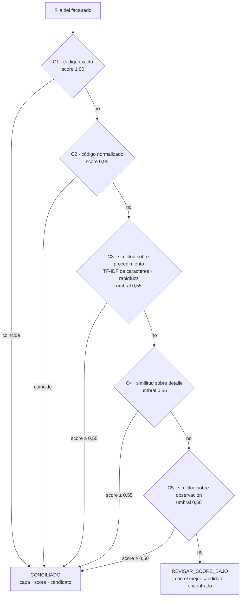

# conciliador-cascada-python

[](https://github.com/jalonba/conciliador-cascada-python/actions/workflows/ci.yml)


Conciliador de registros en Python que empareja lo **facturado** contra un **catálogo/tarifario**
mediante una **cascada de cinco capas**, de la coincidencia exacta de código a la similitud
semántica de texto. Cada fila queda con la capa que la resolvió, su score y el candidato elegido;
lo que no alcanza el umbral sale marcado para **revisión humana**, nunca asignado en silencio.

> Todo el código de este repositorio se escribió desde cero y todos los datos son **100 %
> sintéticos**: se generan con semilla fija y no se versionan.

## El problema

En facturación en salud, el mismo servicio llega escrito de muchas formas: el código con o sin
ceros a la izquierda, con guiones o en minúsculas; la descripción abreviada, sin tildes, con errores
de digitación o con texto añadido; y a veces sin código. Conciliar a mano cientos de miles de filas
contra el tarifario no escala, y un emparejamiento difuso «a ciegas» introduce errores que nadie ve.

La cascada aplica primero las reglas más estrictas y baratas, y solo deja bajar a las capas
semánticas lo que las anteriores no resolvieron, dejando trazabilidad completa.

## La cascada



| Capa | Regla | Score |
|---|---|---|
| C1 | Código exacto (solo se recortan espacios alrededor) | 1,00 |
| C2 | Código normalizado: mayúsculas, sin tildes, sin separadores ni ceros a la izquierda | 0,95 |
| C3 | Similitud sobre `procedimiento`: TF-IDF de n-gramas de caracteres (2–4) y `rapidfuzz` como desempate | umbral 0,55 |
| C4 | Igual sobre `detalle` | umbral 0,55 |
| C5 | Igual sobre `observacion` | umbral 0,50 |

Reglas de diseño:

- **Una fila resuelta no baja a la siguiente capa.** Cada capa solo recibe las pendientes.
- **Nada bajo umbral se asigna en silencio.** Lo que no resuelve ninguna capa sale con estado
  `REVISAR_SCORE_BAJO`, el mejor candidato encontrado y la capa que lo propuso.
- **La ambigüedad no se resuelve al azar.** Un código o texto repetido en el catálogo no se usa
  para conciliar: la fila baja a la siguiente capa o va a revisión.
- **Los códigos alfanuméricos se conservan.** Una validación ingenua tipo `^\d{6}$` descartaría en
  silencio códigos como `89A201`; hay una prueba explícita para ese caso.
- **Desempate acotado.** `rapidfuzz` (`token_sort_ratio`) solo decide entre candidatos cuyo
  score TF-IDF está a menos de 0,02 del mejor.

## Cómo correrlo

Requiere Python 3.11+.

```bash
git clone https://github.com/jalonba/conciliador-cascada-python.git
cd conciliador-cascada-python
python -m venv .venv && source .venv/bin/activate
pip install -e ".[dev]"

# 1. Generar datos sintéticos (catálogo de 6.000 ítems y 250.000 filas facturadas)
python -m datos.generar_sinteticos --filas 250000 --semilla 42 --salida datos/sinteticos

# 2. Conciliar
python -m conciliador --facturado datos/sinteticos/facturado.csv \
                      --catalogo  datos/sinteticos/catalogo.csv \
                      --salida    salida/

# 3. Pruebas y lint
pytest -q
ruff check . && ruff format --check .

# 4. Benchmark (regenera benchmark/resultados.md)
python -m benchmark.correr --filas 250000 --semilla 42 --excel salida/benchmark
```

La CLI lee CSV o XLSX **como texto** (los códigos conservan sus ceros a la izquierda). Columnas
esperadas: `codigo` (obligatoria en ambas tablas) y, opcionalmente, `procedimiento`, `detalle` y
`observacion`.

Salidas:

- `conciliado.xlsx`: todas las filas con `estado`, `capa`, `score`, `candidato`, `capa_candidato`
  y `candidato_procedimiento`.
- `reporte_auditoria.xlsx`: hoja **resumen** (filas y % por capa, umbral y tiempo), hoja
  **revisar** (pendientes ordenadas por score) y hoja **semanticas** (lo resuelto por C3–C5,
  de menor a mayor score, para muestreo de auditoría).

Los libros se escriben en modo *write-only* de `openpyxl` y cualquier texto que empiece por `=` se
guarda como texto, nunca como fórmula.

## Datos sintéticos

`datos/generar_sinteticos.py` inventa un catálogo con códigos aleatorios de 6 caracteres (~15 %
alfanuméricos, algunos con cero inicial) y descripciones combinando vocabulario genérico
(procedimiento + sitio anatómico + calificador). El facturado mezcla escenarios con ruido
controlado:

| Escenario | Peso | Qué simula |
|---|---:|---|
| `exacto` | 42 % | código idéntico |
| `codigo_ruido` | 24 % | guiones, puntos, espacios, minúsculas, ceros de más o de menos |
| `texto_procedimiento` | 16 % | sin código válido; procedimiento con abreviaturas, sin tildes, errores y texto extra |
| `texto_detalle` | 6 % | procedimiento inútil («VER DETALLE»); el detalle trae la información |
| `texto_observacion` | 4 % | solo la observación sirve |
| `degradado` | 2 % | texto truncado y con muchos errores |
| `sin_pareja_ajeno` | 3 % | servicio que no existe en el catálogo |
| `sin_pareja_vecino` | 3 % | combinación plausible que el catálogo **no** tiene (difiere de un ítem real en un calificador) |

Las columnas `_escenario` y `_codigo_verdadero` son la verdad de terreno que usa el benchmark; el
conciliador las ignora. La generación es determinista con la misma semilla, también entre procesos
con distinto `PYTHONHASHSEED` (hay prueba para eso).

## Resultados

### Benchmark sintético (reproducible)

`python -m benchmark.correr --filas 250000 --semilla 42` · catálogo de 6.000 ítems · Python 3.12,
8 núcleos lógicos, Linux (WSL2). Tabla completa en [`benchmark/resultados.md`](benchmark/resultados.md).

| Capa | Umbral | Filas | % del total | Precisión |
|---|---|---:|---:|---:|
| C1 · código exacto | 1,00 | 105.156 | 42,1 % | 100,0 % |
| C2 · código normalizado | 0,95 | 59.884 | 24,0 % | 100,0 % |
| C3 · procedimiento | 0,55 | 51.479 | 20,6 % | 74,3 % |
| C4 · detalle | 0,55 | 15.440 | 6,2 % | 95,5 % |
| C5 · observación | 0,50 | 10.072 | 4,0 % | 100,0 % |
| **REVISAR_SCORE_BAJO** | | **7.969** | **3,2 %** | — |
| **Total** | | **250.000** | **96,8 % resuelto** | **94,25 %** |

- Tiempo de la cascada: **95,7 s** (C3: 58,0 s · C4: 31,6 s · C1+C2: 1,4 s). Exportar los dos
  libros Excel tomó 111,3 s más; la generación de datos, 7,5 s. Memoria máxima: ~610 MB.
- Precisión = candidato igual al código verdadero ÷ filas resueltas por la capa. Las filas sin
  pareja que se concilian cuentan como error.

**Lectura honesta de los números:**

- C1 y C2 no cometen errores: el 66 % del volumen se resuelve por código con precisión del 100 %.
- Los **servicios ajenos** al catálogo (`sin_pareja_ajeno`, 7.332 filas) van **todos** a revisión:
  la cascada no les inventa pareja.
- Las **combinaciones vecinas** (`sin_pareja_vecino`, 7.576 filas), que difieren de un ítem real
  solo en un calificador (p. ej. «BILATERAL» frente a «UNILATERAL»), se concilian **todas** por
  error en C3: la similitud de caracteres supera de largo el umbral de 0,55. Lo mismo pasa con el
  texto `degradado` (88 % conciliado, 2,9 % correcto). Es la limitación principal del enfoque
  léxico, y explica la precisión de 74 % de C3.
- Por eso el reporte de auditoría trae la hoja **semanticas**: lo que resolvieron C3–C5 ordenado
  de menor a mayor score, para muestrear. Las mejoras naturales son un diccionario de abreviaturas,
  una regla de ambigüedad (enviar a revisión cuando el segundo candidato está muy cerca del primero)
  y umbrales por capa calibrados con una muestra etiquetada. No se aplicaron aquí para no ajustar el
  algoritmo a los datos de su propio generador.
- El % resuelto depende de la mezcla de escenarios que elige el generador; no es comparable con el
  resultado en producción.

### En producción (datos reales no incluidos)

Sobre **248.866 registros** de facturación hospitalaria reales, una implementación previa de esta
misma cascada resolvió automáticamente el **82,4 %** en unos **8 minutos**. Ni los datos ni ese
código forman parte de este repositorio; aquí se citan solo como contexto.

## Estructura

```
conciliador/
├── normalizar.py   # mayúsculas, tildes, espacios, ceros a la izquierda, separadores
├── capas.py        # C1…C5 (TF-IDF de caracteres + desempate rapidfuzz)
├── cascada.py      # orquesta las capas; una fila resuelta no baja a la siguiente
├── reportes.py     # conciliado.xlsx y reporte_auditoria.xlsx
└── cli.py          # python -m conciliador --facturado X --catalogo Y --salida Z
datos/generar_sinteticos.py   # datos sintéticos con ruido controlado y semilla fija
benchmark/correr.py           # % por capa, precisión, % a revisión y tiempo
tests/                        # pytest (escritos antes de cada capa)
```

El historial de commits sigue TDD: cada `feat:` va precedido de un `test:` con las pruebas que
lo especifican.

## Autor

**Jairo Alonso Baquero** · [LinkedIn](https://www.linkedin.com/in/jairobaquero-full-stack/)

Licencia [MIT](LICENSE).
